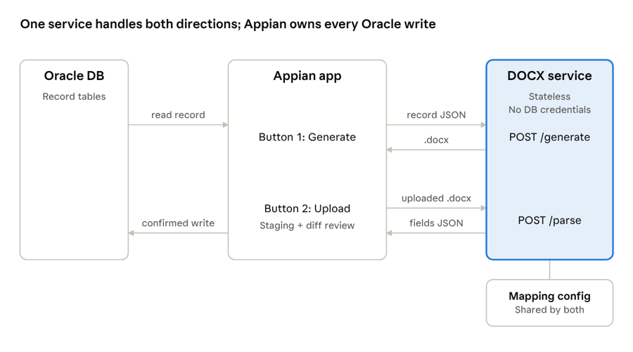

# Appian Oracle ↔ DOCX Service — Requirements & Developer Checklists

Nov 24, 2026 · @Kyle Jovanovic

## Architecture

Build one stateless service that handles both directions using Word content controls, and let Appian own every Oracle read and write.

Button 1 runs along the upper arrows and button 2 along the lower ones. Nothing reaches Oracle until the user confirms the diff.

- **Generation (button 1):** Appian handles this natively with the MS Word 2007 Doc from Template smart service. Template fields are marked with `###key###`.
- **Upload/parse (button 2):** Appian has no native plugin for reading tagged data back out of a .docx.
- **The catch:** the `###key###` markers are replaced on merge, so the generated document has no keys left to parse. Native generation plus custom parsing means two mappings that will drift apart.
- **Recommendation:** one service owns both directions. Each content control's Tag holds the field key, so the same tag marks a field on the way out and on the way back in.
- **Appian keeps the database:** Appian passes record JSON to the service and gets a .docx back. On upload, the service returns JSON and Appian writes it through its records or data store. The service needs no Oracle credentials, and Appian's record security and audit trail stay intact.

## Requirements documentation checklist

The field mapping table is the core artifact. Most other requirements depend on it.

### Scope & actors

- [ ] Which record or entity types the buttons appear on
- [ ] Roles or groups that can generate vs. upload (these may differ)
- [ ] Business trigger and frequency (ad hoc, workflow step, bulk)
- [ ] What happens between download and upload: who edits, offline or not, how long the doc is held

### Template

- [ ] Template owner and change approver
- [ ] Versioning: can several versions be live at once, and are uploads of older versions accepted?
- [ ] Locked regions vs. editable regions
- [ ] Output format: .docx only, or a PDF copy as well
- [ ] Naming convention for generated files

### Field mapping (one row per field)

- [ ] Field key (the content control Tag)
- [ ] Oracle schema.table.column, data type, length or precision, nullability
- [ ] Direction: out only, in only, or both
- [ ] Display format (dates, currency, codes shown as their descriptions)
- [ ] Reverse parse rule (text back to type, description back to code)
- [ ] Repeating sections or tables (child rows), and how inserts, updates and deletes are detected
- [ ] Lookup and reference data validation
- [ ] Business validation rules (ranges, cross-field rules)

### Upload behavior

- [ ] What a blank field means: set to NULL, or no change?
- [ ] Partial vs. full update
- [ ] Concurrency: what happens if the record changed after the doc was generated? (Reject, warn, or merge)
- [ ] Diff or preview shown to the user before commit (strongly recommended)
- [ ] Approval step before the write
- [ ] Error reporting: per-field messages and where they appear
- [ ] Handling of a doc uploaded against the wrong record

### Security & compliance

- [ ] Data classification of the fields (PII, regulated or GxP data)
- [ ] Retention of generated and uploaded docs in Appian Document Management
- [ ] Audit: who, when, old value → new value
- [ ] File restrictions: .docx only, reject .docm and macros, size limit, malware scan
- [ ] Doc protection or encryption requirements

### Non-functional

- [ ] Volume, peak concurrency, latency target for each button
- [ ] Availability and support model (who gets paged)
- [ ] Appian version, hosting (self-managed vs. cloud), network path to the service

### Acceptance

- [ ] Golden test docs: a clean round trip, every field edited, invalid values, wrong template version, stale record, tampered tags

## Developer checklist

The default is Java with docx4j. Choose by what your enterprise already hosts and supports.

### Language / framework

| Option | Fit for this problem | Watch-outs |
| --- | --- | --- |
| Java 17/21 + docx4j | Best fit for an Appian shop: Appian plugins are Java, and docx4j has first-class content control and custom XML data binding. Ships as an Appian plugin or a Spring Boot REST service. | Heavier library; plugin deploys depend on the Appian admins |
| .NET 8 + Open XML SDK | Most complete content control support | Only if you're a Microsoft-hosted shop |
| Python + FastAPI + python-docx + lxml | Workable; matches the team's Python skills | python-docx has no content control API, so you work on the raw XML with lxml. Avoid docxtpl: its tags are consumed on render, like `###` keys. |

- [ ] Pick the language and record the decision as an ADR
- [ ] Pick the hosting: Appian plugin (no extra infrastructure, but tied to Appian admin deploys and more fragile on upgrades) vs. a standalone REST service via Connected System + Integration (independent CI/CD; needs hosting, auth, a network route). Lean REST unless infra blocks it.

### Template engineering

- [ ] Build the template with Developer tab → content controls (Tag = field key, Title = human label)
- [ ] Lock non-editable controls (cannot be deleted / contents cannot be edited)
- [ ] Repeating tables: repeating section content controls, with a hidden row-ID control per row
- [ ] Custom document properties: `template_id`, `template_version`, `record_id`, `row_version` / last-modified timestamp (Appian's free Read Office Doc Properties plugin can read these for routing)
- [ ] Store templates in Appian Document Management, versioned, with a constant pointing to the active one

### Mapping config

- [ ] One source of truth (Oracle config table or versioned JSON in the repo) used by both endpoints
- [ ] Per-field formatter/parser pairs, unit-tested for symmetry: `parse(format(x)) == x`

### Service endpoints

- [ ] `POST /generate`: template id + record JSON → .docx bytes (Base64 for Appian)
- [ ] `POST /parse`: .docx → `{record_id, template_version, fields{}, rows[], errors[]}`
- [ ] `GET /health`, plus a version endpoint
- [ ] Stateless: no DB access, no files left on disk
- [ ] Reject a template or version mismatch, missing required tags, or duplicate tags
- [ ] Ignore anything typed outside a content control, and say so in the user guide

### Appian side

- [ ] Connected System with your enterprise's auth standard (mTLS, an OAuth client credentials grant, or an API key)
- [ ] Integration objects for generate and parse; handle document ↔ Base64 conversion
- [ ] Upload flow: file upload → parse → staging CDT → diff interface → user confirms → write in a single transaction
- [ ] Concurrency check: compare the doc's `row_version` with the current row before writing
- [ ] Audit writes: who, when, field, old value, new value

### Security

- [ ] Validate file type by content, not extension; reject macro-enabled files; enforce a size limit
- [ ] Harden the XML parser (disable external entities, i.e. XXE)
- [ ] No PII in logs; correlation IDs only

### Testing

- [ ] Unit tests: each formatter/parser pair and each validation rule
- [ ] Round-trip tests: generate → parse → assert equality, for every template version
- [ ] Fixture docs actually edited in Word, since Word rewrites the XML (rsids, run splits) in ways a generated fixture won't show
- [ ] Negative fixtures: deleted controls, wrong version, stale record, oversized or malformed files

### CI/CD & ops

- [ ] Pipeline: lint → tests → container image or plugin JAR → deploy to dev, test, then prod
- [ ] Template changes go through the same versioning and review as code
- [ ] Structured logs, latency and error metrics, an alert on the parse failure rate
- [ ] Runbook covering a bad template deploy, a service outage (generation goes down too), and a stuck upload

## Open questions

These two answers decide plugin vs. REST service. Settle them with the Appian platform team before committing to a language.

- [ ] Does the platform team allow custom Appian plugins, or require external services instead?
- [ ] Where can an internal REST service be hosted with a network path from the Appian servers?

## Sources

- [MS Word 2007 Doc from Template Smart Service — Appian docs](https://docs.appian.com/suite/help/26.7/Word_Doc_from_Template_Smart_Service.html)
- [Extracting data from MS Word tags — Appian Community](https://community.appian.com/discussions/f/plug-ins/34537/extracting-data-from-ms-word-tags)
- [Read Office Doc Properties — Appian AppMarket](https://appmarket.appian.com/listings/read-office-doc-properties)
