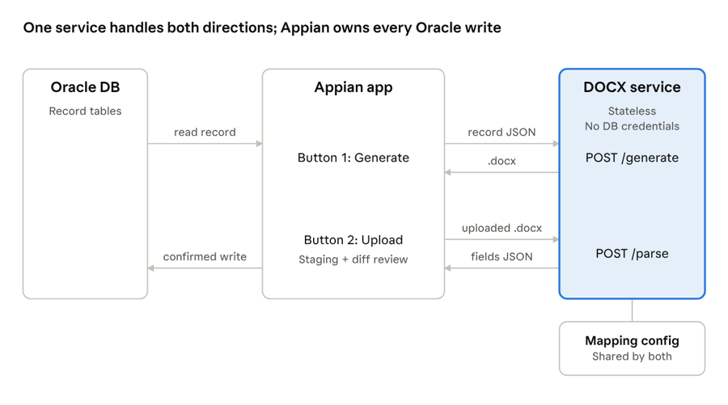

# Appian Oracle ↔ DOCX Service

_Business Analyst Guide_

- [Appian Oracle ↔ DOCX Service](#appian-oracle--docx-service)
  - [Architecture](#architecture)
  - [Requirements Documentation - Checklists](#requirements-documentation---checklists)
    - [Scope \& actors](#scope--actors)
    - [Template](#template)
    - [Field mapping (one row per field)](#field-mapping-one-row-per-field)
    - [Upload behavior](#upload-behavior)
    - [Security \& compliance](#security--compliance)
    - [Non-functional](#non-functional)
    - [Acceptance](#acceptance)

## Architecture

Build one stateless service that handles both directions using Word content controls, and let Appian own every Oracle read and write.

Button 1 runs along the upper arrows and button 2 along the lower ones. Nothing reaches Oracle until the user confirms the diff.

- **Generation (button 1):** Appian handles this natively with the MS Word 2007 Doc from Template smart service. Template fields are marked with `###key###`.
- **Upload/parse (button 2):** Appian has no native plugin for reading tagged data back out of a .docx.
- **The catch:** the `###key###` markers are replaced on merge, so the generated document has no keys left to parse. Native generation plus custom parsing means two mappings that will drift apart.
- **Recommendation:** one service owns both directions. Each content control's Tag holds the field key, so the same tag marks a field on the way out and on the way back in.
- **Appian keeps the database:** Appian passes record JSON to the service and gets a .docx back. On upload, the service returns JSON and Appian writes it through its records or data store. The service needs no Oracle credentials, and Appian's record security and audit trail stay intact.

## Requirements Documentation - Checklists

The field mapping table is the core artifact. Most other requirements depend on it.

### Scope & actors

- [ ] Which record or entity types the buttons appear on
- [ ] Roles or groups that can generate vs. upload (these may differ)
- [ ] Business trigger and frequency (ad hoc, workflow step, bulk)
- [ ] What happens between download and upload: who edits, offline or not, how long the doc is held

### Template

- [ ] Template owner and change approver
- [ ] Versioning: can several versions be live at once, and are uploads of older versions accepted?
- [ ] Locked regions vs. editable regions
- [ ] Output format: .docx only, or a PDF copy as well
- [ ] Naming convention for generated files

### Field mapping (one row per field)

- [ ] Field key (the content control Tag)
- [ ] Oracle schema.table.column, data type, length or precision, nullability
- [ ] Direction: out only, in only, or both
- [ ] Display format (dates, currency, codes shown as their descriptions)
- [ ] Reverse parse rule (text back to type, description back to code)
- [ ] Repeating sections or tables (child rows), and how inserts, updates and deletes are detected
- [ ] Lookup and reference data validation
- [ ] Business validation rules (ranges, cross-field rules)

### Upload behavior

- [ ] What a blank field means: set to NULL, or no change?
- [ ] Partial vs. full update
- [ ] Concurrency: what happens if the record changed after the doc was generated? (Reject, warn, or merge)
- [ ] Diff or preview shown to the user before commit (strongly recommended)
- [ ] Approval step before the write
- [ ] Error reporting: per-field messages and where they appear
- [ ] Handling of a doc uploaded against the wrong record

### Security & compliance

- [ ] Data classification of the fields (PII, regulated or GxP data)
- [ ] Retention of generated and uploaded docs in Appian Document Management
- [ ] Audit: who, when, old value → new value
- [ ] File restrictions: .docx only, reject .docm and macros, size limit, malware scan
- [ ] Doc protection or encryption requirements

### Non-functional

- [ ] Volume, peak concurrency, latency target for each button
- [ ] Availability and support model (who gets paged)
- [ ] Appian version, hosting (self-managed vs. cloud), network path to the service

### Acceptance

- [ ] Golden test docs: a clean round trip, every field edited, invalid values, wrong template version, stale record, tampered tags